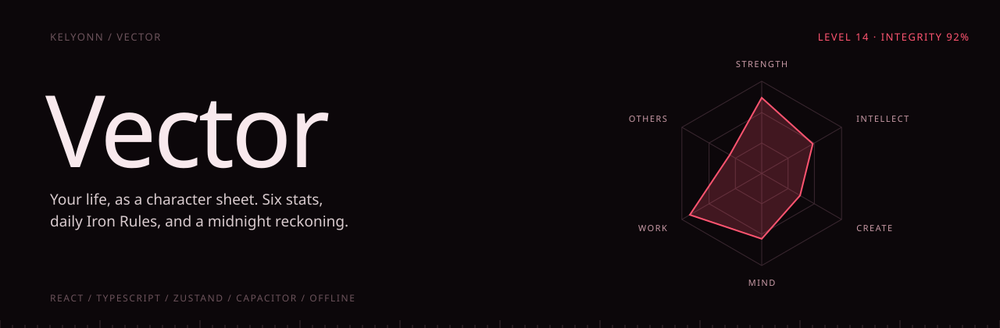
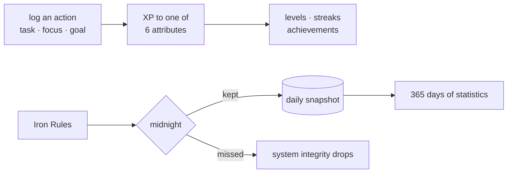

<p align="center">
  
</p>

<p align="center">
  <b>Your life, as a character sheet.</b><br>
  <sub>Six attributes that level up with what you actually do, daily Iron Rules you cannot skip, and a midnight reckoning that remembers whether you kept them.</sub>
</p>

<p align="center">
  <sub>
    <a href="#overview">OVERVIEW</a> &nbsp;·&nbsp;
    <a href="#quick-start">QUICK START</a> &nbsp;·&nbsp;
    <a href="#the-system">THE SYSTEM</a> &nbsp;·&nbsp;
    <a href="#midnight">MIDNIGHT</a> &nbsp;·&nbsp;
    <a href="#your-data">YOUR DATA</a> &nbsp;·&nbsp;
    <a href="#run-it">RUN IT</a>
  </sub>
</p>

<br>

<table>
  <tr>
    <td><sub>ATTRIBUTES</sub><br><b>6</b></td>
    <td><sub>HISTORY</sub><br><b>365 daily snapshots</b></td>
    <td><sub>PLATFORMS</sub><br><b>Web · Android · iOS</b></td>
    <td><sub>ACCOUNT</sub><br><b>None. Local first.</b></td>
    <td><sub>VERSION</sub><br><b>2.0.0</b></td>
  </tr>
</table>

## Overview

Vector turns your days into a character sheet. Six attributes level up with what you actually do, a set of Iron Rules must be kept every day, and at midnight the app keeps score of whether you did.

> [!NOTE]
> There is no account and no server. State lives in IndexedDB on the device, with JSON export and optional sync through a private GitHub Gist.

## Quick start

```bash
npm install
npm run dev               # http://localhost:5173
```

## The daily loop




## The system

**Six attributes.** Strength, Intellect, Create, Mind, Work and Others. Every action you log grants XP to one of them, and attributes level up.

**Iron Rules.** Mandatory daily protocols. The defaults cannot be removed, and they reset at midnight whether you kept them or not.

**Tasks** that are immediate, scheduled or recurring, with priorities, filters and native reminders. **A focus timer** for deep work, with an optional strict mode that penalises quitting early. **Goals** by day, week and month, and **templates** for task sets you repeat.

**Statistics and achievements.** Streaks, charts, attribute growth across a year of history, and milestones for streaks, levels, volume and perfect days.

## Midnight

At midnight the day is closed. Iron Rules reset, energy is restored, and the day's state is saved as a snapshot. Every Iron Rule you missed lowers your **system integrity**. The point is that the app keeps score, so you do not have to.

## Your data

There is no account and no server. State lives on the device in IndexedDB (older localStorage data is migrated automatically).

- **Export and import** the whole thing as one JSON file from Settings.
- **Sync** optionally through a private GitHub Gist, with a token scoped to `gist` only. On conflict, the newer local export wins.

## Run it

```bash
npm install
npm run dev                  # http://localhost:5173
```

On Android (Android Studio, SDK 33+, JDK 17+):

```bash
npm run sync:android         # build and sync into the native project
npm run open:android         # then Run from Android Studio
```

Notifications for Iron Rules, goals and scheduled tasks need the native build; they do not fire in the browser.

> The package id is `com.vector.app`. Builds installed under the old `com.example.app` do not migrate: export your data, uninstall, install the new build, and import.

<details>
<summary><b>Stack and layout</b></summary>
<br>

React, TypeScript, Tailwind and Framer Motion on Vite. Zustand for state, persisted through `idb-keyval`. Recharts for charts. Capacitor for Android and iOS. Views are code-split and lazy-loaded.

```
src/
  components/   dashboard, tasks, statistics, settings
  store/        Zustand stores
  lib/          persistence, sync, notifications, statistics
  types/        definitions
  constants/    app ids and version
```

</details>
